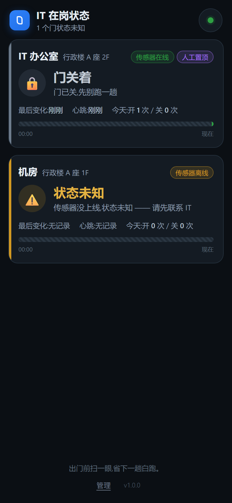

# IT 办公室门磁看板(doorwatch)

> 出门前扫一眼,省下一趟白跑。

给国际学校 IT 部门用的轻量方案:**门磁传感器 → MQTT → 一个网页**,
老师/行政同事在手机上打开就能看到 IT 办公室门是开着还是关着,
不用再跑到办公室门口才发现扑空。



> 📄 **完整架构说明(可视化)**:[`docs/architecture.html`](docs/architecture.html)
> —— 浏览器直接打开,含四层架构图、门禁门磁复用接线原理图、三态判定流程图与成本对比。
> 适合发给同事、物业或领导看。

---

## 目录

- [它解决什么](#它解决什么)
- [整体架构](#整体架构)
- [五分钟跑起来(不用硬件)](#五分钟跑起来不用硬件)
- [硬件清单](#硬件清单)
- [接线](#接线)
- [复用现有门禁门磁(不用买新传感器)](#复用现有门禁门磁不用买新传感器)
- [选型前置检查(动手前先查)](#选型前置检查动手前先查)
- [烧录 ESPHome 固件](#烧录-esphome-固件)
- [正式部署](#正式部署)
- [配置项](#配置项)
- [设计上的几个关键决定](#设计上的几个关键决定)
- [接口一览](#接口一览)
- [日常运维](#日常运维)
- [常见问题](#常见问题)
- [可以往下做的地方](#可以往下做的地方)
- [附录 · 备选方案:米家门磁 + 米家网关 + Home Assistant](#附录--备选方案米家门磁--米家网关--home-assistant)

---

## 它解决什么

IT 部门机动性强,经常不在办公室。现在的做法是:走过去,发现门锁着,白跑一趟。

doorwatch 把这件事变成:**手机上花 2 秒看一眼**。

关键在于它不只是显示"开 / 关",还必须能诚实地显示**"不知道"**。
传感器掉线、没接上、断网的时候,如果还傻乎乎显示"已关门",
那系统在最需要它的时候反而失效了 —— 用户看到"关门"就更不会来了。
所以有三个状态,而且"未知"用醒目的琥珀色单独标出来。

| 看板显示 | 含义 | 老师该怎么理解 |
|---|---|---|
| 🔓 **门开着** | 门磁在线,门是开的 | IT 有人,直接过去 |
| 🔒 **门关着** | 门磁在线,门是关的 | 别跑了,先联系 IT |
| ⚠️ **状态未知** | 传感器离线/未上报/报文异常 | 数据不可信,先联系 IT |

---

## 整体架构

```
   门磁(干接点)                 内置 MQTT broker            看板服务
  ┌────────────┐              ┌──────────────────┐        ┌──────────────┐
  │ ESP32      │   WiFi/MQTT  │  aedes(容器内)   │        │ Node.js      │
  │ + 门磁开关 │ ───────────► │  doorwatch/<id>/ │ ─────► │ + SQLite     │
  │ 60s 心跳   │              │  state/status/   │        │ + REST + SSE │
  └────────────┘              │  heartbeat       │        │ + PWA 页面   │
                              └──────────────────┘        └──────────────┘
                                     ▲                            │
                                     └──── 遗嘱消息 ──────────────┘
                                    (设备掉电时 Broker 代发 offline)
```

**为什么要心跳?** 门一直关着的话,一天可能只有一次状态上报。
只靠状态消息判断"设备是否在线",传感器坏了整整一周都不知道。

**为什么要遗嘱消息?** 设备被拔电/断网时,ESPHome 的 MQTT 遗嘱会由 Broker 代发 `offline`,
看板立刻显示"未知",而不是一直停留在最后那个状态上。

**为什么心跳超时也算离线?** 因为遗嘱消息不是 100% 可靠的(设备被硬拔电、
Broker 重启等场景)。心跳超时是第二道保险。

整个系统**一个容器**搞定:看板 + MQTT broker + 数据库都在里面,
扔到任意一台有 Docker 的 Linux 机器上就能跑,不用另外维护 Mosquitto。

---

## 五分钟跑起来(不用硬件)

先在电脑上把整条链路跑通,确认没问题再去接硬件。

```bash
cd doorwatch
npm install

# 一键演示:起服务 + 模拟两个传感器
node tools/demo.mjs
```

打开 `http://localhost:8081/`,你会看到:

- **IT 办公室** = 门关着(灰色)
- **机房** = 门开着(绿色)
- **IT 备件间** = 状态未知(琥珀色,故意不给它接传感器,演示掉线的样子)

想单独模拟一个传感器:

```bash
node tools/simulate.mjs --open --device it-office-door   # 模拟门开着
node tools/simulate.mjs --cycle 20                        # 每 20 秒自动开/关
node tools/simulate.mjs --drop                            # 模拟传感器掉线
```

跑测试:

```bash
node test/smoke.mjs   # 端到端:服务 + MQTT + 状态机 + 鉴权
node test/ui.mjs      # 浏览器 UI:手机尺寸渲染、点管理、解锁、置顶
```

`test/ui.mjs` 用 Chrome DevTools Protocol 直接驱动真实浏览器,不需要装 Playwright,
跑完会在 `test/artifacts/` 留下手机版和桌面版截图。

---

## 硬件清单

每扇门大概 **￥50–90**:

| 物料 | 规格 | 数量 | 参考价 |
|---|---|---|---|
| ESP32 开发板 | ESP32-DevKitC / ESP32-S3 / ESP32-C3 都行 | 1 | ￥25 |
| **干接点门磁** | 常开型(磁铁靠近时触点闭合),3 线以内 | 1 | ￥15 |
| USB 电源 | 5V 1A | 1 | ￥10 |
| 杜邦线 / 接线端子 | | 若干 | ￥5 |
| 双面胶 / 线卡 | 固定门磁用 | | ￥5 |

> **买门磁时注意**:要**干接点型**(passive / dry contact),不需要额外供电。
> 别买成"磁力锁门磁"那种带 12V/24V 供电的,接线完全不一样。
> 最常见的是**常开型(NO)**:磁铁靠近 → 触点闭合。买回来先用万用表通断档量一下确认。

> **已经有门禁系统的**:不用买门磁,直接复用现有的(加颗光耦隔离即可),
> 还能从门禁借 12/24V 供电。详见[复用现有门禁门磁](#复用现有门禁门磁不用买新传感器)。
> 那样整套硬件约 **￥32**。


门框上没有插座的话,用[电池深度睡眠版固件](#电池版固件门框上没有插座),
换 2 节 AA 电池,续航一年以上。

---

## 接线

以 GPIO21 为例(换成哪个 GPIO 都行,只要是能当输入的脚):

```
   ESP32 GND  ─────┬───── 门磁 COM
                  │
   ESP32 GPIO21 ──┴───── 门磁 NO
```

接上内部上拉之后:

- **门开** → 触点断开 → GPIO 被内部上拉拉高 → **HIGH**
- **门关** → 触点闭合 → GPIO 接地 → **LOW**

安装:

1. **带线的那半片**固定在门框上,**磁铁那半片**固定在门扇上
2. 两者对准,门关上时磁铁正好吸住接点,缝隙留 3–5mm
3. 门磁有极性,装反了不吸合,先用手比划一下
4. 固定好之后,用万用表量一下:磁铁靠近应该"通",离开应该"断"

如果你的门磁是**常闭型(NC)**,把固件里 `binary_sensor` 的 `inverted` 改成 `true` 即可。

---

## 复用现有门禁门磁(不用买新传感器)

学校装了门禁系统的话,门框上**已经有门磁**了 —— 直接复用,省掉一个传感器和一次打孔安装。
但有两件事要分开看:

### 1. 信号:完全可以复用 ✅

门禁控制器上有一对"门磁/DOOR/MAG"端子,接的就是门框上那个磁力开关。
你只要把这两根线**并接**到 ESP32 的 GPIO 上就行,门禁那边照常工作,互不影响。

### ⚠️ 2. 但不能直接接,必须加光耦隔离

这是最容易烧板子的一步。门禁控制器的门磁输入端,内部一般是**12V/24V 经电阻上拉**,
门磁触点接的是控制器的 GND —— 也就是说,门磁线的另一端相对地是 **12V/24V**。

```
   12/24V ──[电阻]──┬── 控制器 DOOR 输入
                     │
                  [门磁触点]            ← 门关时闭合
                     │
                    GND
```

你要是把这条线直接接到 ESP32 的 GPIO,12V 就灌进了一个 3.3V 引脚,
**ESP32 当场烧毁**。加一颗 PC817 光耦(¥1)把两边彻底隔开:

```
【控制器侧 12/24V】                        【ESP32 侧 3.3V】

  门磁 COM ──┬── 控制器 DOOR 输入          3V3 ── 4.7kΩ ──┬── 光耦 C
             └── 1kΩ ──▶|── PC817 LED ──┐               │
                             LED ───────┘             光耦 E ── GND
                                        └── 门磁 NC(接控制器 GND)

逻辑:触点闭合(门关)→ LED 亮 → 光耦导通 → GPIO 低 = 门关
      触点断开(门开)→ LED 灭 → 4.7kΩ 上拉 → GPIO 高 = 门开
```

和 doorwatch 的约定正好一致(高=开,低=关)。实测反了就改 `inverted: true`。

对应固件:**`esphome/it-office-door-optocoupler.yaml`**(和主线固件唯一差别是光耦接法)。

### 动手前先量三处电压

1. **门禁电源是 12V 还是 24V 直流?**
   限流电阻:12V 用 1kΩ/0.25W,24V 用 2.2kΩ/0.5W
2. **门磁两个端子对控制器 GND 的电压?**
   - 门关 ≈0V,门开 ≈12/24V → 控制器有上拉,**必须光耦**
   - 两种状态都 ≈0V → 纯干接点,理论上能直连,但仍建议加光耦(便宜、防呆)
3. **门禁电源带不带 UPS 后备?**
   带最好 —— 停电时门锁还有电、门禁不瘫,你的看板也跟着一起活

### 电源也一起借

ESP32 要 3.3V,门禁那边是 12/24V,中间加个降压模块:

```
  门禁控制器 DC 输入(12/24V) ──▶ MP1584EN 降压模块(12V→5V,¥3) ──▶ ESP32 的 5V/VIN
                                                    │
                                              5V 与 GND 之间并 10uF
```

- ⚠️ **别把 12/24V 接到 ESP32 的 5V 或 VIN**,会烧
- ⚠️ **别把 5V 接到 3V3 引脚**,会绕过板载稳压直供芯片,轻则不稳重则烧
- 优先取**门禁控制器的 DC 输入**或**读卡器供电**(都是常电,好找端子)
- **不要直接取电锁两端的电压** —— 有些门锁是脉冲供电,取不到稳定电压

### 复用方案 BOM(比新买还省)

| 物料 | 数量 | 价格 |
|---|---|---|
| ESP32 开发板 | 1 | ￥25 |
| PC817 光耦 | 2 | ￥2 |
| 电阻 4.7kΩ/1kΩ/2.2kΩ | 若干 | ￥1 |
| MP1584EN 降压模块 | 1 | ￥3 |
| 10uF 电容 | 1 | ￥1 |
| **合计** | | **约 ￥32** |

比新买门磁方案(￥50–90)还便宜,而且不用重新定位门磁。

### 更省事:一个硬件都不用加

如果你们门禁系统有后台软件、并且能推事件(或提供开放 API / Webhook),
那 ESP32 整个都不用了 —— 让门禁系统把"门开/门关"事件推给 doorwatch 就行:

```bash
curl -X POST http://服务器:8443/api/doors/it-office/state \
  -H "X-Admin-Key: 你的密钥" -H "Content-Type: application/json" \
  -d '{"state":"CLOSED"}'
```

这个接口(以及 `POST /api/doors/:id/override`)本来就是为此预留的。
缺点是没有"传感器离线"这个状态 —— 门禁系统挂了看板不会知道。
如果门禁系统是你们自己维护的、状态可查,这个方案最省事。

---

## 选型前置检查(动手前先查)

> 完整版(含降级路径)见 [`docs/architecture.html`](docs/architecture.html) 的「选型前置检查」一节。
> 下面这份是精简版,照着查完再买料。

**A · 门体与门禁侧(现场看)**

- [ ] 门磁是不是**独立端子**?有些门禁把门磁和出门按钮并在一个端子上,得先拆开
- [ ] 门磁是**干接点**还是带供电的?只有干接点能并接
- [ ] 触点"闭合"对应**门开还是门关**?决定固件逻辑极性,反了改 `inverted`
- [ ] 门框附近有没有空位放 ESP32 + 降压模块?(门框上方的箱子里,记得量尺寸)
- [ ] 门禁断电时门是**常开还是常闭**?涉及消防安防,改线前先问物业
- [ ] 厂家质保和改造规定?有些门禁合同不允许第三方动线

**B · 供电侧(必须拿万用表实测,不能猜)**

- [ ] 门禁 DC 输入是 **12V 还是 24V**?
- [ ] 门磁两端子对控制器 GND 的电压?
      门关≈0V、门开≈12/24V → 控制器有上拉,**必须光耦**;两种状态都≈0V → 纯干接点
- [ ] 这路是**常电还是脉冲**?优先取控制器 DC 输入或读卡器供电,**别取电锁**
- [ ] 带不带 **UPS 后备**?带最理想
- [ ] 降压模块**先调到 5V 再接 ESP32**(MP1584EN 出厂默认输出 12V,直接接会烧)
- [ ] 降压模块塞得进盒子吗?带电位器的要留手拧空间

**C · 网络侧**

- [ ] 门边的 WiFi 信号够强吗?(要站在**门框位置**测,别在办公室测)
- [ ] ESP32 能不能访问到服务器?(AP 隔离时,手机能看 ≠ 传感器能连)
- [ ] 服务器是**固定内网 IP** 吗?DHCP 一变固件就找不到 broker,建议路由器上静态绑定
- [ ] 门禁后台有没有**开放 API / 事件推送**?有的话可以零硬件

**D · 下单前确认规格**

- [ ] 门磁:**干接点、常开型**,确认接插件是 2 pin 还是螺丝端子
- [ ] ESP32 开发板尺寸塞得进门边的盒子,Type-C 口更方便
- [ ] 降压模块输入范围覆盖 24V(MP1584EN 上限 28V,够用)
- [ ] PC817 买 **A 档**(CTR 更高)
- [ ] 自购门磁时:门框材质 + 门缝宽度(金属门影响吸合,缝隙以毫米计)
- [ ] 多扇门的话 **deviceId 规划好**,接线和配置要一一对应

**查出来不满足怎么办**

| 情况 | 怎么办 |
|---|---|
| 门磁无法并接 / 不是干接点 | 改自购门磁(￥60/扇门) |
| 门框上取不到电 | 改**电池深度睡眠版**,并把 `ONLINE_TIMEOUT_MS` 放宽到 45 分钟 |
| 门边 WiFi 信号差 | 外置天线 ESP32 / 门边加 AP / 挪位置 |
| 校园网 AP 隔离 | 服务器挪到可互访网段,或 `network_mode: host` |
| 门禁后台有开放 API | **最省事**:零硬件,推事件到 `POST /api/doors/:id/state` |
| 门禁没 API 且门磁不能并接 | 只能自购门磁 + ESP32;门框都动不了的话这扇门不适合做 |

---

## 烧录 ESPHome 固件

```bash
pip install esphome

cd esphome
cp secrets.example.yaml secrets.yaml
# 编辑 secrets.yaml,填 WiFi 账号密码等
```

编辑 `it-office-door.yaml`,把这两处改成你自己的:

```yaml
substitutions:
  mqtt_broker_ip: "192.168.1.10"   # ← 部署 doorwatch 那台机器的 IP
  mqtt_topic_prefix: doorwatch/it-office-door
```

> ⚠️ **`mqtt_topic_prefix` 的最后一段必须和 `config/doors.json` 里的 `deviceId` 完全一致。**
> 这是最容易踩的坑。服务启动时会把每扇门期望的主题打印出来,照着填就不会错:
>
> ```
> [doorwatch]   IT 办公室  ←  主题前缀 doorwatch/it-office-door
> ```
>
> 如果填错了,服务会在日志里明确报警(`收到未登记设备 "xxx" 的消息,已忽略`),
> 不会静默丢数据。

烧录:

```bash
esphome run it-office-door.yaml          # 首次:编译 + USB 烧录
esphome run it-office-door.yaml --device it-office-door   # 之后:OTA 升级
```

固件装好后:

1. 设备会开一个 `IT-Door-Setup` 热点,用手机连上配 WiFi
2. 配完网,设备每 60 秒发一次心跳,状态变化时立即上报
3. 看板上的门卡片会变成"门开着/门关着"

**多扇门怎么办?** 复制一份 YAML,改 `device_name`(ESPHome 设备名)、`mqtt_topic_prefix`
和 `door_pin`(接线脚),然后在 `config/doors.json` 里加一条对应的记录。

### 电池版固件(门框上没有插座)

用 `it-office-door-battery.yaml`,它会深度睡眠、醒来读一次门磁发一次状态再接着睡。

**必须同时放宽服务端的在线判定阈值**,否则 15 分钟才醒一次的设备会被一直判定为离线:

```yaml
# docker-compose.yml
environment:
  ONLINE_TIMEOUT_MS: "2700000"   # 45 分钟
```

---

## 正式部署

### 方式一:Docker(推荐)

```bash
cd doorwatch/deploy
# 按需修改环境变量
docker compose up -d
```

- 看板:`https://<服务器IP>:8443/`
- MQTT:`<服务器IP>:1883`

数据(SQLite / 证书 / 管理密钥)都在 `doorwatch-data` 卷里,容器重建不丢。

### 方式二:直接跑 Node

```bash
cd doorwatch
npm install
DATA_DIR=/var/lib/doorwatch HTTPS=true node server/src/index.js
```

### 方式三:接到学校已有的 MQTT broker

```bash
MQTT_HOST=10.0.0.5 MQTT_PORT_EXTERNAL=1883 \
MQTT_USERNAME=esp MQTT_PASSWORD=xxx \
node server/src/index.js
```

### 证书

首次启动会自动用 `openssl` 生成自签证书(同时把本机所有内网 IP 写进 SAN)。
三个方式可以覆盖:

1. `CERT_FILE` / `KEY_FILE` 指向学校内网 CA 签发的证书(**推荐**,手机不会报证书警告)
2. 手动生成后放进 `$DATA_DIR/cert/{server.crt,server.key}`
3. 什么都不做,用自动生成的自签证书

用自签证书的话,手机第一次打开会提示"不安全" —— 点"高级 → 继续前往"即可,
浏览器记住之后就正常了。想一步到位就用内网 CA 证书。

### 让全校都能看到

1. 找 IT 拿一个内网域名(比如 `doorwatch.school.edu`),解析到服务器 IP
2. `CERT_NAMES=doorwatch.school.edu` 启动,证书就带上这个域名
3. 写个公告,附上链接;iOS Safari「分享 → 添加到主屏幕」就能变成一个 App 图标

**读接口是免登录的**(内网即可访问),这样才有人愿意用。
写操作(人工置顶、webhook)需要管理密钥。

---

## 配置项

全部通过环境变量配置:

| 变量 | 默认值 | 说明 |
|---|---|---|
| `PORT` | `8443` | HTTPS 端口 |
| `HTTP_PORT` | `0` | 额外开一个纯 HTTP 端口(可选) |
| `DATA_DIR` | `./data` | 数据库 / 证书 / 密钥存放目录 |
| `HTTPS` | `true` | 关掉就用纯 HTTP |
| `CERT_NAMES` | 空 | 证书里额外写进去的域名/IP,逗号分隔 |
| `CERT_FILE` / `KEY_FILE` | 空 | 用自己的证书 |
| `MQTT_PORT` | `1883` | 内置 broker 端口 |
| `MQTT_HOST` | 空 | 填了就用外部 broker |
| `ONLINE_TIMEOUT_MS` | `180000` | 心跳超时(毫秒),超时即判定离线 |
| `HIDE_TIMES` | `false` | 隐藏具体时间,只显示开/关 |
| `ADMIN_KEY` | 空 | 留空则自动生成,写到 `$DATA_DIR/ADMIN_KEY.txt` |
| `DOORS_JSON` | 空 | 直接用 JSON 配门禁(容器部署方便) |
| `DOORS_FILE` | `./config/doors.json` | 门禁登记表文件 |

`config/doors.json` 长这样:

```json
{
  "doors": [
    {
      "id": "it-office",
      "name": "IT 办公室",
      "location": "行政楼 A 座 2F",
      "deviceId": "it-office-door",
      "openHint": "IT 有人在,直接过来就行",
      "closedHint": "门已关,IT 暂时不在,先别跑一趟"
    }
  ]
}
```

`openHint` / `closedHint` 是显示在卡片上的一句话,按学校习惯改。

---

## 设计上的几个关键决定

**1. 传感器离线时显示"未知",而不是显示最后的状态。**
门磁挂掉之后会保持最后一次上报的状态。如果直接显示出来,一旦最后是"关门",
那传感器死了整整一周、看板都显示"已关门",用户一看更不会来 —— 系统在最需要的时候彻底失效。
所以:确认设备有心跳 **且** 状态合法,才敢显示开/关。
这条被拆成了三道可测的防线(状态值、时间戳、在线标记),任何一道不过就降级成"未知"。

**2. 独立心跳,不靠状态消息判断在线。**
门一直关着 = 一天可能只有一条状态消息。
心跳只回答"设备此刻还活着吗",**不回答"门是开是关"** ——
所以心跳不会把一个已经降级成"未知"的状态复活成"门开着"。

**3. 状态用 retain,但重放的旧消息不算"活着"。**
服务重启后订阅主题,立刻能拿到最后状态,不用等下一次开关门。
但 broker 重放的是**历史数据**,拿它证明"设备还活着"是错的 ——
所以重放只更新状态,不刷新心跳、不改在线标记。
(实测 aedes:实时转发 `retain=false`,只有重放才是 `retain=true`。)

**4. 未知设备的告警不静默丢弃。**
`deviceId` 填错是最常见的错误,收到未登记设备的消息会直接在日志里喊出来。

**5. 页面资源带版本戳。**
服务端给 `index.html` 注入 `?v=<戳>`,改完前端刷新就生效,
不会让已经"添加到主屏幕"的用户卡在旧版界面上。

**6. 不引 node-forge。**
自签证书用系统的 `openssl` 生成,避开一个未修复的高危安全公告,少一个依赖。

---

## 接口一览

| 方法 | 路径 | 说明 |
|---|---|---|
| GET | `/api/doors` | 所有门当前状态 + 今日统计 + 今日事件 |
| GET | `/api/doors/:id` | 单扇门 |
| GET | `/api/doors/:id/events?limit=100` | 历史开关门记录 |
| GET | `/api/events?limit=50` | 全局最近事件 |
| GET | `/api/stream` | SSE 实时推送(页面用的就是这个) |
| GET | `/api/health` | 健康检查 |
| GET | `/api/admin/verify` | 校验管理密钥 |
| POST | `/api/doors/:id/state` | 外部系统推门磁状态(webhook 通道),**需密钥** |
| POST | `/api/doors/:id/override` | 人工置顶 `{state, hours}`,**需密钥** |
| DELETE | `/api/doors/:id/override` | 取消置顶,**需密钥** |

密钥通过 `X-Admin-Key` 头、`Authorization: Bearer <key>` 头或 `?key=` 传。

**接学校现有门禁系统?** 如果门禁系统能推 webhook,用 `POST /api/doors/:id/state` 接进来就行:

```bash
curl -X POST http://服务器:8443/api/doors/it-office/state \
  -H "X-Admin-Key: 你的密钥" \
  -H "Content-Type: application/json" \
  -d '{"state":"CLOSED"}'
```

---

## 日常运维

```bash
# 看服务日志
docker logs -f doorwatch

# 看传感器有没有接上
docker logs doorwatch | grep 传感器

# 健康检查
curl -k https://服务器:8443/api/health

# 手动把某扇门置顶成"关门"(比如全员出差两天)
curl -X POST http://服务器:8443/api/doors/it-office/override \
  -H "X-Admin-Key: $KEY" -H "Content-Type: application/json" \
  -d '{"state":"closed","hours":48}'
```

看板底部的"管理"按钮里也能直接点,更方便。

**看历史数据**:SQLite 库在 `$DATA_DIR/doorwatch.db`,

```bash
sqlite3 /var/lib/doorwatch/doorwatch.db \
  "SELECT datetime(at/1000,'unixepoch','localtime') t, door_id, to_state FROM events ORDER BY at DESC LIMIT 20;"
```

---

## 常见问题

**Q:手机上打不开看板,提示连接不上?**
多半是校园网开了 **AP 隔离**。同一个 WiFi 下的设备之间不能互访。
解决:看板服务器要接在能通到用户网段的位置,或者用 `network_mode: host`,
或者走内网域名 + 反向代理。
**注意:这个问题同样会影响 ESP32 连 MQTT broker** —— 手机能看不代表传感器能连上,
两者要在同一个可互访的网络里。

**Q:看板一直显示"状态未知"?**
按顺序查:
1. 服务日志里有没有"传感器接入"的记录 → 没有就是 ESP32 没连上 broker,查 WiFi 和 broker IP
2. 有接入但没状态 → 查 `mqtt_topic_prefix` 和 `config/doors.json` 的 `deviceId` 是否一致
3. 之前有状态、后来变未知 → 查传感器供电和心跳

**Q:刚装好没反应?**
门磁接线可能反了。用万用表量:磁铁靠近应该"通"。
或者固件里把 `inverted` 改成 `true`。

**Q:老师会不会随便点坏?**
读操作免登录,改不了任何东西。要改东西(置顶)需要管理密钥,存在浏览器本地。

**Q:能看到门开没开,会不会暴露"IT 什么时候在"?**
默认会显示具体时间。如果不想这样,把 `HIDE_TIMES=true` 打开,
看板只显示开/关,时间显示"已隐藏"。

**Q:能不能顺便看出谁进出了?**
现在的记录只有开门/关门,没有身份信息。要做到人脸/工牌级别,
门磁就不够了,得接读卡器 —— 而且从隐私角度看,学校多半也不希望这么干。

---

## 可以往下做的地方

- **接门禁系统**:用 `POST /api/doors/:id/state` 把现有门禁的开关门事件推进来,不用装硬件
- **接 Home Assistant**:ESPHome 固件本来就发标准 MQTT,HA 能直接发现;也可以反过来用
  HA 的 API 把状态推进 doorwatch
- **加 Telegram / 企业微信告警**:门开着超过 N 分钟就提醒"(门开着很久了,是不是忘锁了)"
- **补上电池主题**(当前缺口):`esphome/it-office-door-battery.yaml` 已经在发
  `${prefix}/battery`,但服务端还没订阅这个主题、`doors` 表也没有 battery 列,
  所以电量显示不出来。补上之后就能做低电量提醒 —— 对蓝牙门磁来说,
  这是唯一能提前发现"门磁快没电了"的手段(见附录里的局限说明)
- **多楼层扩展**:这套东西跟门禁系统解耦,加门就是加一条 `doors.json` 记录 + 一个传感器

---

## 附录 · 备选方案:米家门磁 + 米家网关 + Home Assistant

> 门框动不了线、也没门禁可蹭电时的兜底路。**不动线、不借电、不烧固件**,
> 门磁贴上去、网关插电就完事 —— 代价是多一层系统要维护。
> 可视化版见 [`docs/architecture.html`](docs/architecture.html) 的「备选方案」一节。
> **完整接入步骤见 [`ha/README.md`](ha/README.md)** —— 那份是照着做就能装的操作手册。

**链路**:`米家门磁(纽扣电池)` → `米家网关` → `Home Assistant` → `doorwatch 看板`

关键点:**doorwatch 的服务端不掺任何硬件假设**,只订阅
`doorwatch/<deviceId>/state` 主题。所以换传感器不改一行代码,只改采集端。

**成本**:门磁 ￥60–90(Aqara 磁力门吸 / 小米门窗传感器 2),网关 ￥150–300
(学校已有 Aqara 网关的话,边际成本只有一个门磁)。

### ★ 先确认门磁是蓝牙还是 Zigbee

这一步决定用哪个集成,别跳过。

| 型号 | 无线 | 需要什么网关 |
|---|---|---|
| **小米门窗感应器 2**(MCCGQ02HL) | **蓝牙 5.1 BLE** | 蓝牙网关 / 蓝牙 Mesh 网关 |
| 小米门窗感应器(一代) | Zigbee | 多模网关 / Aqara 网关 |
| Aqara 磁力门吸 E1 / H1 | Zigbee | 多模网关 / Aqara 网关 |

> 依据:小米官网 [Mi Door and Window Sensor 2 FAQ](https://www.mi.com/hk/support/faq/details/KA-05476/)
> 明确写着「小米门窗感应器 2 需搭配蓝牙网关,小米门窗感应器需搭配 Zigbee 网关」。

### ★ 再确认用哪个集成

| 集成 | 支持 BLE 门磁? | 支持 Zigbee 门磁? |
|---|---|---|
| **Xiaomi Home**(小米官方) | **不支持** | 支持 |
| **Xiaomi Miot Auto**(社区) | **支持** | 支持 |

- **你的门磁是 BLE 版(大概率)→ 必须用 `xiaomi_miot`**,官方集成会直接看不到这台设备。
- 万一门磁是 Zigbee 版 → 两个都能用,优先官方 `Xiaomi Home`。

> 依据:官方集成 [ha_xiaomi_home](https://github.com/XiaoMi/ha_xiaomi_home) 的文档写明
> 「蓝牙设备、红外设备和虚拟设备目前不在支持范围内」;
> 社区集成 [hass-xiaomi-miot](https://github.com/al-one/hass-xiaomi-miot) 的项目描述即
> "support Wi-Fi, **BLE**, ZigBee devices"。

**别两个都装。** 先装 `xiaomi_miot`,门磁没出现再考虑换官方集成。

**安装 `xiaomi_miot` 的四种方式**(详细步骤见 [`ha/README.md`](ha/README.md)):

| 方式 | 操作 | 适合 |
|---|---|---|
| **HACS** | HACS → 集成 → ➕ → 搜 `Xiaomi Miot Auto` → 下载 → 重启 HA | 网络通畅时最省事 |
| **SSH 一键装** | `wget -O - .../install.sh \| ARCHIVE_TAG=latest bash -` | HA OS / Supervised |
| **手动拷贝** | 把 `custom_components/xiaomi_miot` 拷进配置目录 | 任何环境 |
| **shell_command** | 写进 `configuration.yaml`,开发者工具里调用 | HA OS 上不想开 SSH |

> ★ **只要这一个集成的话,别装 HACS** —— HACS 要绑 GitHub 账号、要过 GitHub 网络,
> 以后还得管更新。直接用上面的 **SSH 一键装**或 **shell_command**,一条命令到位。
>
> ★ **「添加集成」里搜不到 HACS 不是故障**,是下面两种情况之一:
> - **HA ≥ 2026.11**:HACS 已被官方内置为 **Marketplace**,路径是 **设置 → Marketplace**(不在侧边栏),
>   而且 HA 会**阻止**你再装旧的 HACS 自定义集成。
> - **HA ≤ 2026.10**:HACS 是自定义集成,**装上本体之前必然搜不到**。先按
>   [`ha/README.md` 的 A-1](ha/README.md) 把 HACS 本体装进去(容器就是
>   `wget -O - https://get.hacs.xyz | bash -`),重启 HA 后才搜得到。
>
> 依据:[HACS 官方文档 · HACS and the Marketplace](https://hacs.xyz/docs/marketplace/)

添加集成时选 **账号集成 + 云端模式**。BLE 门磁只能走云端,
选「本地模式」会直接变 unavailable。区域要选对(中国大陆选 `cn`)。

> ★ **门磁是靠轮询读的,延迟 15–30 秒,不是实时推送。**
> 作者在 [issue #100](https://github.com/al-one/hass-xiaomi-miot/issues/100#issuecomment-909031222)
> 里写明:人体/门磁/无线开关这类设备状态本质是「事件」,
> 默认 15 秒轮询一次,「不适合拿去做实时触发的自动化」。
> 对 doorwatch 完全够用(你的需求本来就是「出门前扫一眼」),
> 但别指望靠调小 `interval_seconds` 把延迟压到实时 —— 作者说了做不到。

### 步骤

1. 装 Home Assistant(有 Docker 就能跑)和 `xiaomi_miot` 集成,门磁加进网关
2. 确认实体名 —— 磁力门吸会同时暴露 `door`(开合)和 `motion`(靠近)两个,**要用 `door` 那个**
   - 用探针脚本一次问清楚:`node tools/ha-probe.mjs --host http://<HA>:8123 --token <TOKEN>`
3. 让两边对上 broker,二选一:
   - **HA 没有 MQTT broker** → HA 的 MQTT 集成指向 doorwatch 的 `1883`,doorwatch 端**零改动**
   - **HA 已有 Mosquitto** → doorwatch 设 `MQTT_HOST` / `MQTT_PORT_EXTERNAL` / `MQTT_USERNAME` / `MQTT_PASSWORD`,**同样零代码改动**
4. 装 [`ha/templates.yaml`](ha/templates.yaml) 和 [`ha/automations.yaml`](ha/automations.yaml)
   —— 里面已经处理好了「方向反了」「传感器掉线」「HA 重启」这几个坑
5. `config/doors.json` 里加对应门的记录,`deviceId` 和自动化里的主题后缀**必须一致**

> **门磁已经在 HA 里了?** 直接照着 [`ha/CHECKLIST.md`](ha/CHECKLIST.md) 做,
> 那是 6 步操作清单,含验收用例和故障对照表。完整原理见 [`ha/README.md`](ha/README.md)。

### 三条自动化在干什么

`ha/automations.yaml` 里这三条,和 README 顶部写的是同一套逻辑:

```yaml
# 1. 门磁状态 → doorwatch(状态一变就发,门一开看板马上变)
triggers:
  - trigger: state
    entity_id: sensor.doorwatch_it_office_door_state
actions:
  - action: mqtt.publish
    data:
      topic: "doorwatch/it-office-door/state"
      payload: "{{ states('sensor.doorwatch_it_office_door_state') }}"
      qos: 1
      retain: true

# 2. 每分钟体检(★ 本项目正确性的关键,别删)
#    先强制模板重算 —— 模板默认不会按时重算,不刷它新鲜度判据就是死的
#    活着 → 推状态 + 心跳;读不到 → 立刻推 offline
triggers:
  - trigger: time_pattern
    minutes: "/1"
actions:
  - action: homeassistant.update_entity
    target:
      entity_id:
        - sensor.doorwatch_it_office_door_state
        - sensor.doorwatch_it_office_door_readable
  - if:
      - condition: template
        value_template: >
          {{ states('sensor.doorwatch_it_office_door_readable') == 'on'
             and (as_timestamp(now())
                  - as_timestamp(states('sensor.doorwatch_it_office_door_readable').last_updated)) < 120 }}
    then:
      - action: mqtt.publish
        data:
          topic: "doorwatch/it-office-door/state"
          payload: "{{ states('sensor.doorwatch_it_office_door_state') }}"
          qos: 1
          retain: true
      - action: mqtt.publish
        data:
          topic: "doorwatch/it-office-door/heartbeat"
          payload: "alive"
          qos: 1
          retain: false
    else:
      - action: mqtt.publish
        data:
          topic: "doorwatch/it-office-door/status"
          payload: "offline"
          qos: 1
          retain: false

# 3. HA 启动时补发一次,避免看板长时间停留在旧状态
triggers:
  - trigger: homeassistant
    event: start
actions:
  - delay: "00:01:00"
  # ... 同上:先刷模板,活着就推状态+心跳,读不到就推 UNKNOWN + offline
```

> 用的是 HA 2024.10+ 的新语法(`triggers` / `actions` + `action:`)。
> 新版 HA 里 `service:` 已被 `action:` 取代,老写法会弹弃用警告。
>
> ★ 要改的只有 `templates.yaml` 里的实体名。`automations.yaml` 里出现的
> `sensor.doorwatch_it_office_door_*` 是本套模板自己定义的实体,名字固定。

### ★ 中间那层 `templates.yaml` 最重要,三个陷阱都在这

它把原始实体收敛成一个三态字符串(`OPEN` / `CLOSED` / `UNKNOWN`),并解决三个陷阱:

**陷阱一:方向可能反。** 不同集成里 `on` 未必等于「门开着」——
MIoT 规范里门磁的属性叫 `contact-state`,「磁铁靠近(门关)=true」。
方向开关在 `DOOR_ON_MEANS_OPEN`,反了改一行就行。

**陷阱二(更要命):传感器掉线时,实体不会变成 unavailable。**
`xiaomi_miot` 在设备无响应时,实体**无限期保留最后一次读到的状态**
(社区 issue [#2699](https://github.com/al-one/hass-xiaomi-miot/issues/2699),
集成作者确认这是轮询机制导致,异常没映射到 `available` 属性)。

如果只看 `states()` 是 `on` 还是 `off`,那么**门磁电池耗尽后,看板会一直显示
「门开着」** —— 传感器明明死了,看板却在撒谎。这正是本项目最要避免的事。

所以判断传感器死活用的是**状态最后一次更新的时间**:

```yaml
{{ (as_timestamp(now()) - as_timestamp(states.binary_sensor.xxx.last_updated)) < 180 }}
```

**陷阱三:模板实体不会按时重算。**
上面那个判据要成立,前提是模板在那一刻真的被重新算了一遍。
但 HA 的模板默认只在「引用的实体状态变了」时才重算 ——
而传感器死了以后状态值是不变的(`on` 还是 `on`),模板也就不重算,
新鲜度判据会一直卡在最后一次的结果上。

所以第 2 条自动化每分钟用 `homeassistant.update_entity` 强行重算一次,
并且额外检查「模板自己是不是刚被刷新过」(120 秒内)——
万一实体名写错导致刷新失效,宁可报「未知」,也绝不能报「还活着」。

### 服务端怎么配合:三道防线

模板输出 `UNKNOWN` 时,**doorwatch 服务端认识这个值** —— 收到就把状态打回
「未知」并标记离线,而不是当成看不懂的垃圾值扔掉。

| 消息 | 服务端行为 |
|---|---|
| `state` = `OPEN` / `CLOSED` | 记为门状态,刷新心跳 |
| `state` = **`UNKNOWN`** | **状态打回「未知」+ 标记离线** |
| `status` = `offline` | 标记离线,立刻降级为未知 |
| `heartbeat` = `alive` | 只证明「还活着」,**不会**把状态从「未知」变回开/关 |

于是有三重保险,任何一道生效,看板都不会显示过期的开/关:

1. 模板输出 `UNKNOWN` → 推给 doorwatch → 立刻打回未知(实测 64ms)
2. 「每分钟体检」推 `status=offline` → 立刻打回未知(实测 3ms)
3. doorwatch 自己的心跳超时(180 秒)→ 兜底

另外服务端还处理了一件容易被忽略的事:**broker 重放的 retained 旧消息只更新状态,
不算「设备还活着」**。否则服务端一重启,几天前的旧状态就会诈尸。

### 设备在路上时,可以先做的

```bash
node tools/demo.mjs --mode ha      # 完整模拟 HA 接入
node test/ha-path.mjs               # HA 路径的端到端测试(24 项)
node test/freshness.mjs             # 「不许撒谎」的不变量单元测试(24 项)
```

`--mode ha` 模拟的是 HA 自动化的行为:**状态变化才发消息,传感器读不到就不发心跳**。
所以硬件还没到,就能验证「传感器掉线 → 看板显示状态未知」这条最关键的路径。

还可以直接模拟新加的 `UNKNOWN` 路径:

```bash
node tools/simulate.mjs --mode ha --unreadable --push-unknown --push-offline
```

### 注意

- **★ 传感器掉线时实体不会变 unavailable**:`xiaomi_miot` 会无限期保留最后一次读到的状态
  (社区 issue [#2699](https://github.com/al-one/hass-xiaomi-miot/issues/2699),作者已确认)。
  所以 `ha/templates.yaml` 用**实体最后一次「上报」的时间**(`last_reported`)判断传感器死活,
  失联时立刻推 `status=offline`,看板马上降级成「状态未知」。
  **这一层不做,看板就会在传感器死后继续撒谎。**
  - ★ 这里必须用 `last_reported` 而不是 `last_updated`:HA 里状态和属性都没变时,
    只有 `last_reported` 会推进,`last_updated` 会**冻住**。
    用错了会出现「传感器好好的,看板一直显示状态未知」。
    细节见 [`ha/README.md`](ha/README.md)。
  - ★ HA 模板语法坑:`states('x')` **只返回状态文本**,拿时间戳得写 `states.x.last_reported`。
    写错成 `states('x').last_reported` 会每分钟抛模板错误,自动化直接哑火。
- **★ 蓝牙方案的固有局限**:门磁自己没电了、但网关和云都正常时,
  米家云会把**最后一次的值**继续返回,HA 这边一切正常 ——
  **看板看不出门磁已经死了**。这不是 bug,是「门磁不主动上报」的必然结果。
  想要真正测得到传感器死活,得走 ESPHome 方案(自己发心跳)。
  详见 [`ha/CHECKLIST.md`](ha/CHECKLIST.md) 第 6 步的用例 3.5。
- **★ 服务端认识 `UNKNOWN`**:HA 的模板在传感器读不到时会输出 `UNKNOWN`,
  doorwatch 收到就把状态打回「未知」并标记离线,不会当成垃圾值丢掉后继续显示旧状态
- **延迟**:BLE 门磁只能走云端。`xiaomi_miot` 全局轮询间隔默认 30 秒,
  但**门磁这类事件型设备默认 15 秒**(作者在 [issue #100](https://github.com/al-one/hass-xiaomi-miot/issues/100#issuecomment-909031222) 里说的)。
  可以在 `configuration.yaml` 里用 `xiaomi_miot: { interval_seconds: 30 }` 调整。
  **不建议低于 15 秒** —— 轮询太频繁容易触发小米云风控,而且作者明确说过
  对拿不到「最后触发事件」的设备,调到 1 秒也拿不到正确状态。
- **★ token 约 7 天会过期**:社区大量报告用着用着全体设备失联,日志是 `SERVICETOKEN_EXPIRED`。
  表现是门磁不再更新 → 模板输出 `UNKNOWN` → 不发光跳 → 看板显示「状态未知」。
  **行为是安全的(不会撒谎),但看板会失灵。** 解法:每周自动重载一次集成,
  写法见 [`ha/README.md`](ha/README.md)
- **数据出户**:默认会经过米家云(中国大陆机房)。只是开关状态,没有身份信息,
  但如果学校对数据出户有规定,先跟行政确认
- **想全本地**:对**蓝牙网关**这条路是死的 —— 小米蓝牙网关没有公开的刷写方式。
  刷社区固件(ESPHome 版 aqara-gateway 之类)只对 Zigbee 网关可能
- **电池**:纽扣电池约 1–2 年,在 HA 里建个低电量提醒
- **只给 IT 内部用**:HA 的 Lovelace 卡片 + 手机 App 就够了,doorwatch 都可以不装
- **BLE 门磁离线时**:看板显示「状态未知」是**正确行为**,不是故障

**三个方案怎么选**

| 你的情况 | 选哪个 |
|---|---|
| 门框不能动线,也没有门禁可蹭 | **米家 + HA**,唯一能落地的 |
| 学校已有 Aqara 网关 / 已在跑 HA | **米家 + HA**,边际成本最低 |
| 只想给 IT 内部看,不上全校 | **米家 + HA 卡片**,连 doorwatch 都不用 |
| 门框能拉线、有门禁可蹭电 | **ESP32 方案**,￥32 最便宜且完全自控 |
| 要完全掌控、离线可用、不依赖米家云 | **ESP32 方案**,全程不出内网 |

---

## 项目结构

```
doorwatch/
├── server/src/          # 后端
│   ├── index.js         #   HTTP(S) 服务 + 路由 + 静态托管
│   ├── broker.js        #   内置 MQTT broker + 订阅传感器主题
│   ├── db.js            #   SQLite(node:sqlite,免原生编译)
│   ├── state.js         #   状态机:open / closed / unknown 的判定
│   ├── doors.js         #   门禁登记表
│   ├── certs.js         #   openssl 自签证书
│   └── live.js / sse.js #   SSE 推送
├── public/              # 手机端看板(PWA)
├── esphome/             # ESPHome 固件
│   ├── it-office-door.yaml            #   USB 供电版(自己装门磁)
│   ├── it-office-door-optocoupler.yaml#   复用现有门禁门磁(光耦隔离)
│   └── it-office-door-battery.yaml    #   电池深度睡眠版(门框没插座)
├── ha/                  # Home Assistant 接入套件(米家门磁方案)
│   ├── CHECKLIST.md      #   ★ 门磁已接入 HA 之后的 6 步落地清单 + 验收用例
│   ├── templates.yaml    #   三态归一化 + 方向开关 + 新鲜度判据
│   ├── automations.yaml  #   三条自动化:状态上报 / 每分钟体检 / 启动补发
│   └── README.md         #   完整接入手册(装 xiaomi_miot、找实体、坑位清单)
├── deploy/              # Dockerfile / docker-compose.yml
├── tools/
│   ├── demo.mjs         #   一键演示
│   ├── ha-probe.mjs     #   HA 探针:找门磁实体 / 验方向 / 看时间戳
│   └── simulate.mjs     #   传感器模拟器
├── test/
│   ├── freshness.mjs    #   「不许撒谎」的不变量单元测试
│   ├── smoke.mjs        #   端到端测试
│   ├── ha-path.mjs      #   HA 接入路径的端到端测试
│   └── ui.mjs           #   浏览器 UI 测试(CDP)
└── config/doors.json    # 门禁登记表
```

技术栈:**Node.js 24 + SQLite(node:sqlite)+ MQTT(aedes)+ PWA**。
只依赖 `aedes` 和 `mqtt` 两个包,没有原生模块,换机器不用编译。
